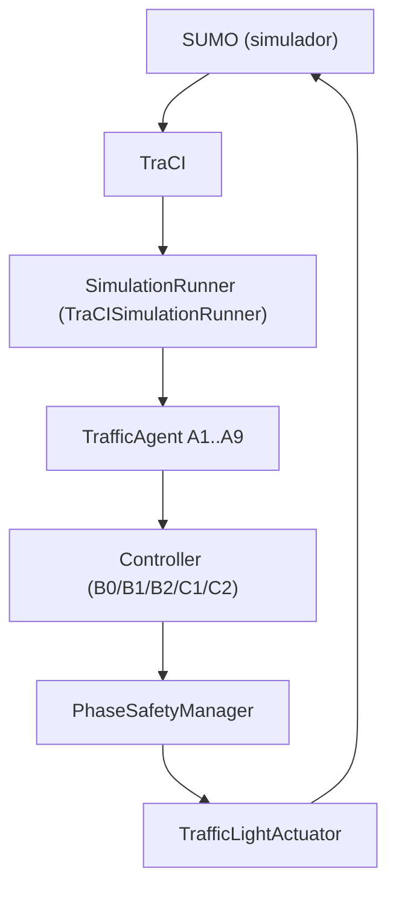
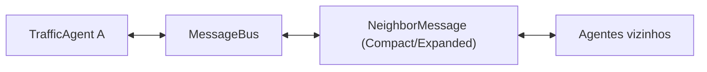
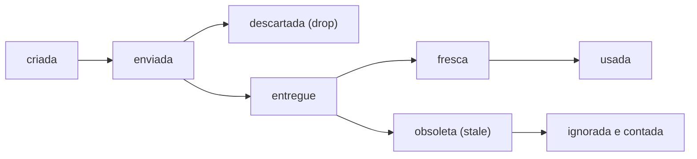
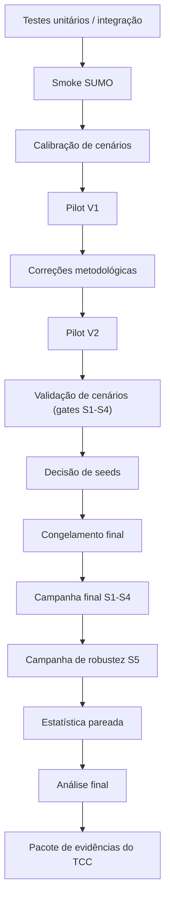

# Plano de Testes e Validação Experimental do Sistema Multiagente de Controle Semafórico

## SUMO + TraCI + Python — Rede Urbana Simulada 3x3

> **Status do documento.** Referência oficial de testes do projeto. Todas as informações foram
> extraídas da implementação atual, dos documentos de metodologia (`docs/`, `docs/methodology/`),
> das configs em `experiments/configs/` e dos artifacts locais de `artifacts/experiments/pilot_v1/`
> e `artifacts/experiments/pilot_v2/` (o diretório `artifacts/` é ignorado pelo git, mas está
> disponível localmente e foi usado como evidência). Nenhuma simulação nova foi executada para
> escrever este documento, e nenhum resultado foi inventado.

> **Resultado do Pilot V2 em uma frase.** `RESULT_INTERPRETATION=MIXED`,
> `RESULT_CONFIDENCE=MEDIUM`, `C1_GENERAL_SUPERIORITY_CLAIMED=NO`,
> `C1_SCENARIO_SPECIFIC_BENEFIT=S4`, `READY_FOR_TCC_USE=YES`. O Pilot V2 **não** provou
> superioridade geral do C1 sobre o B2. Detalhes nas seções 18 e 31.

## Sumário

1. [Introdução](#1-introdução)
2. [Pergunta científica](#2-pergunta-científica)
3. [Sistema sob teste](#3-sistema-sob-teste)
4. [Controladores sob teste](#4-controladores-sob-teste)
5. [Princípio da comparação justa](#5-princípio-da-comparação-justa)
6. [Seeds aleatórias](#6-seeds-aleatórias)
7. [Testes de software / engenharia](#7-testes-de-software--engenharia)
8. [Testes visuais / manuais no SUMO-GUI](#8-testes-visuais--manuais-no-sumo-gui) (inclui a saída do comando e a escolha de `--max-steps`)
9. [S1 — Tráfego balanceado](#9-s1--tráfego-balanceado)
10. [S2 — Pico direcional](#10-s2--pico-direcional)
11. [S3 — Mudança abrupta de demanda](#11-s3--mudança-abrupta-de-demanda)
12. [S4 — Saturação localizada](#12-s4--saturação-localizada)
13. [Política de teleports do S4](#13-política-de-teleports-do-s4)
14. [S5 — Degradação da comunicação](#14-s5--degradação-da-comunicação)
15. [Teste opcional de atraso de comunicação](#15-teste-opcional-de-atraso-de-comunicação)
16. [Testes antes/depois](#16-testes-antesdepois)
17. [Pilot V1](#17-pilot-v1)
18. [Pilot V2](#18-pilot-v2)
19. [Contabilidade de população](#19-contabilidade-de-população)
20. [Warmup versus janela de medição](#20-warmup-versus-janela-de-medição)
21. [Métricas de fila](#21-métricas-de-fila)
22. [Teste de green-hold](#22-teste-de-green-hold)
23. [Testes de comunicação](#23-testes-de-comunicação)
24. [Tabela de métricas](#24-tabela-de-métricas)
25. [O que é um resultado promissor](#25-o-que-é-um-resultado-promissor)
26. [Regras de interpretação](#26-regras-de-interpretação)
27. [Análise estatística](#27-análise-estatística)
28. [Artifacts dos experimentos](#28-artifacts-dos-experimentos)
29. [Reprodutibilidade](#29-reprodutibilidade)
30. [Fluxo de testes](#30-fluxo-de-testes)
31. [Status atual do projeto](#31-status-atual-do-projeto)
32. [Plano da campanha final](#32-plano-da-campanha-final)
33. [Conexão com o TCC](#33-conexão-com-o-tcc)

---

## 1. Introdução

O projeto simula uma rede urbana em grade **3x3** com nove interseções semaforizadas, identificadas
de **A1 a A9**. Cada interseção é controlada por um **agente semafórico descentralizado**: ele
observa apenas o seu próprio entorno e decide sozinho qual fase verde atender. Em alguns
controladores, o agente também recebe mensagens de vizinhos permitidos (controle **cooperativo**).

| Componente | Papel |
| --- | --- |
| **SUMO** | Simulador microscópico de tráfego: veículos, lanes, semáforos e fluxo. |
| **TraCI** | Interface de comunicação em tempo de execução entre Python e o SUMO (leitura de sensores, comando de fases). |
| **Python** | Agentes, controladores, mensagens, métricas e orquestração dos experimentos. |

A rede versionada (`scenarios/grid_3x3/network.net.xml`) tem uma lane por aproximação, arestas
internas de 235,6 m e arestas de borda de 92,8 m. O programa de tempo fixo tem 98 s e atende uma
aproximação por vez.

> **O objetivo NÃO é simplesmente provar que o controlador cooperativo é "melhor".** O objetivo
> real é determinar:
>
> - **sob quais condições de tráfego** a cooperação ajuda;
> - **quando o controle local já é suficiente**;
> - **quais custos de comunicação** existem;
> - **quão robusta** a cooperação é à perda e ao atraso de mensagens;
> - **como o comportamento dos controladores muda** sob perturbações de tráfego.

## 2. Pergunta científica

> "Em uma rede urbana simulada, a troca local de informações entre controladores semafóricos
> descentralizados melhora o desempenho da rede em comparação com um controlador adaptativo local
> sem cooperação e com controle de tempo fixo, sob diferentes condições de demanda?"

O resultado pode ser **positivo**, **neutro** ou **negativo**. Os três são cientificamente válidos:
um resultado neutro ou negativo mostra onde a cooperação *não* compensa, o que também responde à
pergunta.

## 3. Sistema sob teste



Nos controladores cooperativos, existe um segundo canal, lateral ao ciclo acima:



Pontos importantes:

- cada interseção age de forma independente (não há sincronização global horizontal/vertical);
- a comunicação só ocorre entre vizinhos permitidos pela `CommunicationTopology`
  (`src/traffic_agents/communication/topology.py`);
- **topologia de tráfego** (quais vias ligam as interseções) e **topologia de comunicação** (quem pode
  enviar mensagem a quem) são conceitos diferentes; o hash da topologia de comunicação
  (`communication_topology_sha256`) é registrado separadamente;
- o `PhaseSafetyManager` valida toda intenção do controlador (verde mínimo, verde máximo, amarelo,
  all-red, transições permitidas) antes de o `TrafficLightActuator` aplicá-la; estados brutos de
  sinal nunca são comandados.

## 4. Controladores sob teste

| ID | Tipo | Informação usada | Comunicação | Lógica de decisão | Papel no experimento |
| --- | --- | --- | --- | --- | --- |
| `B0_FIXED` | Baseline estático | Nenhuma (não emite atuação) | Nenhuma | Mantém o programa de tempo fixo do SUMO (`tlLogic` versionado em `network.net.xml`); não é calibrado por Webster | Referência de controle não adaptativo |
| `B1_LOCAL_ADAPTIVE` | Adaptativo local | Observação local da interseção | Nenhuma | Compara a pressão de fila (queue) da fase verde atual com a das fases concorrentes após `min_green_seconds` | Baseline adaptativo simples |
| `B2_LOCAL_PRESSURE` | Adaptativo local (pressure) | Observação local da interseção | Nenhuma | Pressão de movimento: `queue_weight * upstream_queue + arrival_rate_weight * arrival_rate - downstream_occupancy_weight * min(outgoing_occupancy / downstream_saturation_occupancy, 1.0)` | Referência local do **núcleo de pressão**; comparação primária com C1 |
| `C1_COOPERATIVE_COMPACT` | Cooperativo compacto | Observação local + `CompactNeighborMessage` | Mensagens compactas entre vizinhos | Mesmo núcleo de pressão do B2, ajustado pela demanda projetada compacta e pelo congestionamento a jusante informado pelo vizinho | Efeito da cooperação |
| `C2_COOPERATIVE_EXPANDED` | Cooperativo expandido | Observação local + `ExpandedNeighborMessage` | Mensagens expandidas (mais campos) | Mesmo núcleo e mesmo caminho de segurança do C1/B2, com sinais adicionais da mensagem expandida | Benefício adicional de comunicação mais rica |

Fonte: `docs/methodology/controllers.md` e `src/traffic_agents/controllers/`.

### 4.1 B2 versus C1 — a comparação científica primária

- **B2** usa somente informação local.
- **C1** usa **o mesmo núcleo de pressão local do B2** e acrescenta apenas a informação compacta dos
  vizinhos.
- Sem mensagens válidas, as pontuações de fase do C1 são **iguais** às do B2 para a mesma observação
  e o mesmo estado de segurança (fallback documentado).

Logo, a diferença entre B2 e C1 isola o **efeito da cooperação**: tudo o mais é igual.

### 4.2 C1 versus C2

Avalia se uma comunicação **mais rica** (C2) traz benefício adicional em relação à comunicação
**compacta** (C1), e a que custo em bytes e mensagens.

## 5. Princípio da comparação justa

O desenho é **pareado**. Para o mesmo `cenário + seed`, todos os controladores comparados devem
compartilhar:

- rede;
- arquivo de rotas;
- demanda de tráfego;
- razões de conversão (turning ratios);
- plano de fases;
- warmup;
- duração da medição;
- passo de simulação (`step_length`);
- restrições de segurança.

Somente o comportamento do controlador (e, quando projetado, o de comunicação) muda.

O `manifest.json` de cada run registra hashes que comprovam isso:

| Hash | O que garante |
| --- | --- |
| `network_sha256` | Mesma rede SUMO |
| `route_sha256` | Mesmo arquivo de rotas / demanda |
| `phase_plan_sha256` | Mesmo plano de fases |
| `movement_model_sha256` | Mesmo modelo de movimentos |
| `turning_config_sha256` | Mesma configuração de conversões |
| `communication_topology_sha256` | Mesma topologia de comunicação |
| `scenario_sha256` | Mesmo YAML de cenário |

Entradas idênticas tornam a comparação entre controladores cientificamente significativa: uma
diferença de desempenho pode ser atribuída ao controlador, e não a uma demanda diferente. A ferramenta
`src/traffic_agents/experiments/run_invariants.py` verifica essas invariantes entre runs (no Pilot V1,
0 divergências).

## 6. Seeds aleatórias

Uma **seed** é o número que inicializa o gerador pseudoaleatório. O tráfego é estocástico
(instantes de partida com fase aleatória, escolhas de conversão em cada junção), então:

> mesma seed + mesmo cenário = mesma demanda/rotas geradas (byte a byte, confirmado por `route_hash`).

Seeds do piloto (fixadas antes da execução): **42, 2027, 3253, 4517, 5791**. O pool pré-declarado
(`campaign_v1_seed_pool_2026-09-29`) é `42, 2027, 3253, 4517, 5791, 6841, 8089, 10007, 12011, 16001`.

Por que várias seeds:

- uma única run pode ser atípica;
- os resultados devem ser avaliados como **distribuição**;
- a comparação pareada usa a **mesma seed** entre controladores.

> A contagem final de seeds **ainda não foi definida formalmente**; ela será decidida somente após
> a avaliação do piloto (ver seção 31). As seeds não podem ser substituídas, removidas nem
> reordenadas por causa dos resultados dos controladores.

## 7. Testes de software / engenharia

Os testes de software verificam que o **sistema está correto**. Eles são distintos dos testes
experimentais (seções 9 a 16), que verificam **o que o sistema mostra** sobre a pergunta científica.

| Tipo | Pergunta que responde | Onde |
| --- | --- | --- |
| **Software** | O código faz o que deveria? A segurança semafórica vale? As mensagens se comportam? | `tests/`, ruff, mypy |
| **Experimental / científico** | O cenário é válido? O que muda entre controladores? Quão confiável é a diferença? | Runs em `experiments/`, gates, análise pareada |

Comandos da suíte automatizada (rodados no repositório):

```powershell
python -m ruff check .
python -m ruff format --check .
python -m mypy src
python -m pytest -q
```

(Com a `.venv` ativa: `.venv\Scripts\Activate.ps1`.)

### 7.1 Ruff

Análise estática de qualidade de código (linting): imports não usados, erros comuns, estilo.

### 7.2 Ruff format

Verifica consistência de formatação (`ruff format --check .`), sem alterar arquivos.

### 7.3 mypy

Verificação estática de tipos em `src`.

### 7.4 pytest

Testes unitários e de integração em `tests/`. A contagem atual está registrada na seção
[7.9](#79-resultado-da-validação-desta-documentação).

Arquivos e temas principais:

| Arquivo | Tema |
| --- | --- |
| `test_phase_safety.py`, `test_green_hold.py`, `test_green_hold_sumo.py` | Segurança de fases e green-hold |
| `test_message_bus.py`, `test_compact_neighbor_message.py`, `test_communication_topology.py` | Comunicação |
| `test_fixed_time_controller.py`, `test_local_adaptive_controller.py`, `test_local_pressure_controller.py`, `test_cooperative_compact_controller.py` | Controladores |
| `test_traffic_demand.py`, `test_route_walk.py`, `test_route_artifacts.py`, `test_generate_grid.py`, `test_scenario_config.py`, `test_traffic_model.py` | Demanda, rotas e rede |
| `test_run_metrics.py`, `test_metric_definitions.py`, `test_sumo_trip_metrics.py`, `test_network_telemetry.py`, `test_step_telemetry.py`, `test_performance_profile.py` | Métricas e telemetria |
| `test_experiment_runner.py`, `test_experiment_aggregate.py`, `test_experiment_freeze.py`, `test_experiment_report.py`, `test_run_invariants.py`, `test_analysis_statistics.py`, `test_generate_s5_matrix.py` | Orquestração e análise |
| `test_sumo_runner.py`, `test_sumo_environment.py`, `test_traci_sensor_adapter.py`, `test_pipeline_sumo.py` | Integração com SUMO/TraCI |

### 7.5 Smoke tests com SUMO

Simulação curta (`--max-steps` pequeno, ou o teste `tests/test_pipeline_sumo.py`) para confirmar que:

- o SUMO inicia;
- o TraCI conecta;
- o cenário carrega;
- os veículos se movem;
- o controlador roda (o procedimento de validação exige `B0_FIXED`, `B2_LOCAL_PRESSURE` e um
  controlador cooperativo);
- a simulação encerra corretamente.

### 7.6 Validação de artifacts de rota

`validate_route_artifacts` (`src/traffic_agents/experiments/route_artifacts.py`) e
`scripts/validate_scenario.py` verificam:

- seed;
- cenário;
- hash de config (`config_hash`, `scenario_hash`);
- hash de rotas (`route_hash`) e de rede (`network_hash`);
- janelas de demanda por entrada;
- contagens de veículos oferecidos;
- proporções de movimentos realizadas a até 0,03 das razões configuradas.

`tests/test_route_walk.py` confirma as expectativas estruturais (cobertura do S1, parcela dominante
do S2, momento e roteamento do choque do S3, concentração em A5 no S4).

### 7.7 Testes de segurança

Em `tests/test_phase_safety.py`, `tests/test_green_hold.py` e `tests/test_green_hold_sumo.py`:

- **sem verdes conflitantes** (programa de fases com estados/movimentos conflitantes é rejeitado);
- **verde mínimo** (troca antecipada bloqueada até `min_green_seconds`; troca no limite exato permitida);
- **verde máximo** (`max_green_seconds` força a transição);
- **amarelo** (não pode ser encurtado nem escolhido como alvo pelo controlador);
- **all-red / clearance** preservado na sequência;
- **atuação segura** (transição inválida rejeitada; a sequência deve seguir o programa do SUMO).

### 7.8 Testes de comunicação

Em `tests/test_message_bus.py` e `tests/test_compact_neighbor_message.py`:

- **entrega** de mensagens (uma vez, no passo correto);
- **atraso** (`delay_steps`: 1 passo e 3 passos não entregam antes do previsto);
- **perda de pacotes** (`drop_probability` 0 não perde nada; 1 perde tudo; intermediária reprodutível com seed fixa);
- **mensagens obsoletas** (o bus entrega mensagens antigas sem classificá-las; a classificação de
  *stale* é feita pelo controlador via `max_message_age_steps`);
- **ordenação determinística** (por passo de entrega e sequência);
- **RNG com seed** (a mesma sequência de publicação é reproduzível; seed diferente pode mudar a sequência de perdas).

### 7.9 Resultado da validação desta documentação

Saída real das quatro validações, executadas com a `.venv` do projeto (`python -m ...`) em 2026-09-30:

| Validação | Resultado |
| --- | --- |
| `python -m ruff check .` | `All checks passed!` |
| `python -m ruff format --check .` | `107 files already formatted` |
| `python -m mypy src` | `Success: no issues found in 45 source files` |
| `python -m pytest -q` | `353 passed` |

Este número reflete o estado do repositório na data acima e muda conforme testes são adicionados.

## 8. Testes visuais / manuais no SUMO-GUI

O SUMO-GUI serve para **depuração, demonstração e inspeção de comportamento**. Ele **não** é a fonte
principal de conclusões científicas: conclusões vêm das runs headless pareadas (seções 9 a 16 e 27).

Exemplos de inspeção sugeridos:

| Combinação | O que observar |
| --- | --- |
| `B0_FIXED` em S1 | Comportamento base do tempo fixo em tráfego balanceado |
| `B0_FIXED` em S2 | Fila crescendo no corredor Oeste→Leste sem adaptação |
| `B2_LOCAL_PRESSURE` em S3 | Reação local ao choque de demanda |
| `C1_COOPERATIVE_COMPACT` em S3 | Mesma situação com informação dos vizinhos |
| `B2_LOCAL_PRESSURE` em S4 | Congestionamento em A5 e propagação |
| `C1_COOPERATIVE_COMPACT` em S4 | Resposta cooperativa perto da região congestionada |

O que inspecionar visualmente:

- veículos percorrendo a grade;
- conversões à esquerda, à direita e em frente;
- fases semafóricas independentes em A1–A9;
- ausência de sincronização global horizontal/vertical;
- fases de amarelo;
- all-red / clearance;
- formação de filas;
- veículos liberando as junções;
- resposta cooperativa perto de áreas congestionadas.

Formato do comando (script direto, com a `.venv` ativa; o script não tem `--seed`, pois a seed vem
do YAML do cenário):

```powershell
python scripts\run_simulation.py `
  --scenario <scenario.yaml> `
  --controller-id <controller> `
  --gui `
  --step-delay-ms 40 `
  --max-steps <N>
```

Exemplo concreto (S4, seed 42):

```powershell
python scripts\run_simulation.py --scenario scenarios\grid_3x3\scenario_s4_local_saturation_seed_42.yaml --controller-id C1_COOPERATIVE_COMPACT --gui --step-delay-ms 40 --max-steps 900
```

Alternativa pela CLI do projeto (aceita `--seed`):

```powershell
python -m traffic_agents simulation run --scenario scenarios/grid_3x3/scenario_s4_local_saturation_seed_42.yaml --controller C1_COOPERATIVE_COMPACT --seed 42 --gui --step-delay-ms 40 --max-steps 900
```

### 8.1 O que o comando retorna

O `scripts/run_simulation.py` abre o SUMO-GUI, executa o cenário passo a passo (1 passo = 1 s
simulado) e, ao terminar (ou ao atingir `--max-steps`), imprime no terminal:

```text
simulation start
simulation end
started_at=...
ended_at=...
controller_id=...
controller_version=...
demand_profile=...          (S1_BALANCED, S2_DIRECTIONAL_PEAK, S3_DEMAND_SHIFT ou S4_LOCAL_SATURATION)
seed=...
steps_executed=...
vehicles_departed=...
vehicles_arrived=...
wall_time_seconds=...
manifest=artifacts\runs\<run_id>\manifest.json     (ausente com --no-manifest)
```

Como ler:

| Campo | Significado |
| --- | --- |
| `steps_executed` | Passos executados. A run completa tem **3900** (300 s de warmup + 3600 s de medição); com `--max-steps 900` para em 900 |
| `vehicles_departed` | Veículos inseridos na rede |
| `vehicles_arrived` | Veículos que concluíram a viagem. `departed - arrived` = ainda circulando |
| `wall_time_seconds` | Tempo real gasto (inclui `--step-delay-ms`) |
| `manifest` | Caminho do manifesto da run (proveniência: hashes, seed, versões) |

> **Este script é para inspeção visual.** Ele grava o `manifest.json` e os arquivos da run, mas as
> métricas científicas completas (`run_metrics.json` com `mean_time_loss`, filas, razões de conclusão
> etc.) são produzidas pelo executor de experimentos
> (`python -m traffic_agents experiment run --config <config.yaml>`), que roda o pipeline canônico
> de métricas. Não use a saída do script visual como resultado científico.

### 8.2 Escolhendo `--max-steps`

| Objetivo | `--max-steps` sugerido | Motivo |
| --- | --- | --- |
| Smoke rápido (SUMO abre, veículos andam, semáforos mudam) | 300 a 900 | Ainda dentro do warmup + início da medição |
| Ver o **choque do S3** | **>= 2400** (ideal: run completa) | O choque começa no passo **2100**; com 900 passos ele nunca aparece |
| Ver a **saturação do S4** se formar | >= 1200 (ideal: run completa) | A fila em A5 cresce ao longo do tempo |
| Run completa | omitir `--max-steps` | 3900 passos |

Com `--step-delay-ms 40`, a run completa leva ao menos 3900 x 0,04 s ≈ **156 s** só de pausa, fora o
custo de renderização. Use `--step-delay-ms 0` para ir mais rápido, ou aumente para observar
detalhes. Nos comandos das seções 9 a 12, `<CTRL>` é o controlador escolhido:
`B0_FIXED`, `B1_LOCAL_ADAPTIVE`, `B2_LOCAL_PRESSURE`, `C1_COOPERATIVE_COMPACT` ou
`C2_COOPERATIVE_EXPANDED`.

---

## 9. S1 — Tráfego balanceado

### Propósito

Regime estável e balanceado, servindo de base para os demais cenários.

### Perfil de tráfego (configuração atual)

- todas as 12 entradas de borda injetam a mesma taxa (nível `MEDIUM`, **150 veh/h** por entrada,
  valor calibrado no Prompt 46.7);
- razões de conversão: **70% em frente (straight), 15% à esquerda (left), 15% à direita (right)**;
- cada uma das nove interseções concentra cerca de 11% das passagens por junções (sem cantos ociosos).

> Os valores do Pilot V1 (regime superssaturado) estão obsoletos e não devem ser usados (ver seção 17).

### O que o S1 testa

- comportamento sob demanda previsível;
- capacidade-base da rede;
- se controladores adaptativos introduzem oscilação desnecessária;
- se a cooperação é útil mesmo sem perturbação forte.

### Métricas principais

`throughput`, população (`offered`/`departed`/`arrived`), razões de conclusão (`completion_ratio_*`),
`mean_waiting_time`, `mean_time_loss`, `mean_travel_time`, `mean_stops`,
`mean_network_queue_vehicles`, `max_network_queue_vehicles`, `max_lane_queue_vehicles`.

### O que torna o cenário válido

Verificações de regime estável (aplicadas às runs de referência `B0_FIXED`):

- sem backlog estrutural de inserção;
- `departure_ratio` alto;
- fila que não cresce indefinidamente;
- todas as regiões da grade recebem tráfego.

> Não se define "o C1 deve vencer". O S1 responde se a cooperação ajuda, é neutra ou atrapalha em
> tráfego estável.

### Como executar e observar o S1

**Comando** (Windows PowerShell, `.venv` ativa):

```powershell
python scripts\run_simulation.py --scenario scenarios\grid_3x3\scenario_s1_balanced_seed_42.yaml --controller-id <CTRL> --gui --step-delay-ms 40 --max-steps 900
```

Pares sugeridos para inspecionar: `B0_FIXED` (referência), `B2_LOCAL_PRESSURE` e `C1_COOPERATIVE_COMPACT`. Outra seed: troque o arquivo (`seed_2027`, `seed_3253`, `seed_4517`, `seed_5791`).

**O que o comando retorna:** o bloco da seção 8.1 com `demand_profile=S1_BALANCED`, `seed=42` e
`steps_executed` igual a 900 (ou 3900 na run completa).

**O que observar no SUMO-GUI:**

- as 12 bordas injetando veículos de forma parecida, com a grade ocupada por igual (sem cantos vazios);
- cada interseção com fases independentes, sem onda verde global;
- conversões em frente (maioria) e à esquerda/à direita (minorias, cerca de 15% cada);
- filas curtas que se formam e se dissipam a cada ciclo, sem crescer sem limite;
- amarelo e all-red antes de cada troca.

**Como ler o resultado** (sem afirmar vencedor entre controladores):

- `vehicles_departed` deve ficar próximo do oferecido (no gate, `departure_ratio >= 0,98`);
- `vehicles_arrived` cresce de forma contínua, sem estagnar;
- filas crescendo sem parar, ou muitos veículos esperando para entrar na borda, indicam que o regime não é o estável esperado;
- para comparação com o Pilot V2 (feita na análise pareada, não na inspeção visual): no S1 o C1 ficou pior que o B2 em atraso e fila e neutro em throughput.

## 10. S2 — Pico direcional

### Propósito

Simular um forte fluxo direcional do tipo deslocamento pendular.

### Comportamento do tráfego

- demanda dominante **Oeste → Leste**: as três entradas oeste (grupo `dominant`, `MEDIUM` 320 veh/h
  cada) respondem por cerca de **80%** da demanda oferecida;
- as outras nove bordas (grupo `residual`, 320/12 ≈ 26,67 veh/h cada) respondem pelos 20% restantes;
- as conversões 70/15/15 continuam existindo (os 80% referem-se à demanda oferecida, não a veículos
  que seguem em frente por toda a rede).

### O que o S2 testa

- tratamento de desbalanceamento direcional;
- progressão no corredor;
- capacidade de servir pelotões de veículos;
- se a informação cooperativa ajuda o conhecimento a jusante.

### Métricas

`mean_stops`, `mean_waiting_time`, `mean_time_loss`, `throughput`, `corridor_throughput`,
`corridor_mean_travel_time`, `corridor_mean_stops`, filas de rede e a razão de partida por entrada
(`entry_departure_ratio` por entrada e por grupo).

### Demanda oferecida versus demanda realmente inserida

- **oferecida (offered):** o que o perfil de demanda programou por entrada;
- **inserida/partida (departed):** o que o SUMO conseguiu de fato colocar na rede.

A diferença importa porque congestionamento na borda pode impedir a inserção e **esconder o perfil de
tráfego pretendido**. Por isso as entradas dominantes foram calibradas para manter razão de partida
dominante `>= 0,90`, e o `run_metrics.json` reporta `offered/departed/arrived` e
`entry_departure_ratio` por entrada e por grupo para verificar isso em tempo de execução.

### Como executar e observar o S2

**Comando** (Windows PowerShell, `.venv` ativa):

```powershell
python scripts\run_simulation.py --scenario scenarios\grid_3x3\scenario_s2_directional_peak_seed_42.yaml --controller-id <CTRL> --gui --step-delay-ms 40 --max-steps 900
```

Pares sugeridos: `B0_FIXED`, `B2_LOCAL_PRESSURE` e `C1_COOPERATIVE_COMPACT`. Este também é o cenário-base do S5 (perda de pacotes).

**O que o comando retorna:** o bloco da seção 8.1 com `demand_profile=S2_DIRECTIONAL_PEAK`, `seed=42` e
`steps_executed` igual a 900 (ou 3900 na run completa).

**O que observar no SUMO-GUI:**

- forte fluxo entrando pelas **três bordas oeste** e seguindo para leste, formando pelotões no corredor;
- fluxo residual fraco vindo das outras nove bordas;
- fila crescendo nas aproximações das interseções da borda oeste;
- nos adaptativos, se o verde do eixo leste-oeste é estendido quando há pelotão (verde acima de 20 s, até 60 s);
- conversões ainda presentes no fluxo dominante (o 80% é demanda oferecida, não veículos em linha reta pela rede toda).

**Como ler o resultado** (sem afirmar vencedor entre controladores):

- compare a fila nas entradas oeste entre controladores;
- cuidado com o viés: menor atraso pode vir junto com **menos** veículos concluídos (foi o que o Pilot V2 mostrou no S2 para o C1: menor atraso/fila, porém menor throughput e conclusão);
- por isso confira sempre `vehicles_departed` e `vehicles_arrived`, além do que se vê na tela.

## 11. S3 — Mudança abrupta de demanda

O S3 é um experimento **antes/depois**: mede a adaptação temporal, não só a eficiência em regime
estacionário.

### 11.1 Antes do choque

- a primeira metade usa a base do **S1** (mesmas 12 entradas e taxas, desde t = 0);
- a rede já deve estar em regime estável;
- não deve haver backlog estrutural.

### 11.2 Momento do choque

O choque ocorre em **50% da janela de medição**. Configuração atual confirmada:
`traffic.shock_start_seconds = 2100` (= `warmup_seconds + measurement_duration_seconds / 2` =
300 + 3600/2), ou seja, 1800 s após o início da medição. O validador de cenário rejeita qualquer
outro valor.

### 11.3 Depois do choque

- a demanda muda de forma abrupta: a base continua e três entradas oeste (grupo `shock`, `MEDIUM`
  150 veh/h cada, com viés para straight 0,90/0,05/0,05) são adicionadas;
- esses veículos usam `via_intersection_id: A5`, então passam pela interseção central;
- a rede deve reagir sem reconfiguração manual.

### 11.4 O que é comparado antes versus depois

| Métrica | Significado |
| --- | --- |
| `pre_shock_mean_network_queue_vehicles` | Fila média da rede antes do choque |
| `post_shock_mean_network_queue_vehicles` | Fila média da rede depois do choque |
| `post_shock_max_network_queue_vehicles` | Pico de fila da rede depois do choque |
| `post_shock_time_loss` | Perda de tempo depois do choque |
| `post_shock_queue_auc_vehicle_seconds` | Área sob a curva de fila (AUC) depois do choque |

**AUC:** integral da fila total da rede ao longo do tempo após o choque. Unidade: **veículo·segundo**.
Quanto menor, menos "carga de fila acumulada" o controlador deixou passar.

> No Pilot V1 esses nomes existiam (`post_shock_queue_auc` etc.), mas a definição de série não estava
> congelada e o valor foi inflado por duplicação de filas (seção 17). No Pilot V2 a definição é a
> congelada em `docs/methodology/metrics.md`.

### 11.5 Latência de adaptação

Há uma verificação de "resposta visível ao choque" nas etapas de calibração e de validade do cenário
(`scripts/calibrate_scenarios.py`: `shock_latency_seconds`, exigência de razão de fila `>= 1,25` e
latência `<= 600 s`). Ela mede **quanto tempo o sistema de tráfego leva para exibir uma reação
mensurável** ao choque; não implica que o controlador "entenda" o evento de forma cognitiva.

### 11.6 Gate de estabilidade

**Gate oficial atual (composto, Prompt 47/48).** O S3 é válido se, no intervalo pré-choque
(300–2100 s), avaliado com a run de referência `B0_FIXED`:

1. **sem backlog estrutural:** `departure_ratio >= 0,98` e atraso médio de inserção `<= 5 s`;
2. **sem veículos relevantes nunca inseridos:** fração `<= 0,02`;
3. **sem saturação estrutural de lane:** fração de lane-passos com fila `>= 0,8 x` capacidade da lane `<= 0,02`;
4. **janela agregada de 1800 s pré-choque estável:** variação projetada por regressão (OLS) `<= 0,10 x max(média da janela, 5)`;
5. **pelo menos 4 de 5 seeds** válidas nos critérios 1 a 4.

Verificações mantidas inalteradas: base == S1, primeira metade == S1, choque em 2100 s, origem na
borda oeste, choque passando por A5, resposta visível, sem backlog de inserção de milhares de
segundos e AUC pela definição congelada.

**Resultado do Pilot V2:** S3 aprovado, **5/5 seeds válidas** (4 `VALID` e a seed 4517 como
`VALID_WITH_DIAGNOSTIC_WARNING`).

**Gate diagnóstico antigo (histórico).** O critério anterior de **360 s** (últimos 20% da medição
pré-choque) foi considerado sensível demais à flutuação estocástica normal: falso-fail medido de
cerca de **22% por seed** em tráfego estável e sem backlog (4 de 18 observações independentes). Ele
foi substituído como critério decisório pela janela de 1800 s (limiares inalterados) e mantido como
**diagnóstico** que não reprova seed. A falha de 360 s da seed 4517 (variação projetada de
6,51 veículos contra o limite de 5,00) continua reportada.

> **Nota histórica.** Documentos antigos dizendo que o S3 bloqueia o piloto refletem o estado do
> Prompt 46.8. Isso foi **superado pelo gate composto** (Prompt 48).

Ressalvas (declaradas): a janela de 1800 s foi escolhida *depois* de observar os diagnósticos do
Prompt 46.9; a regra de 4 de 5 seeds é grosseira para 5 seeds.

### 11.7 O que o S3 traz para o TCC

O S3 testa a **adaptabilidade temporal** — como a rede reage a uma mudança abrupta — e não apenas a
eficiência em regime estacionário.

### Como executar e observar o S3

**Comando** (Windows PowerShell, `.venv` ativa):

```powershell
python scripts\run_simulation.py --scenario scenarios\grid_3x3\scenario_s3_demand_shift_seed_42.yaml --controller-id <CTRL> --gui --step-delay-ms 40 --max-steps 2700
```

Use `--max-steps` **>= 2400** (ou omita para a run completa), pois o choque só começa no passo 2100. Pares sugeridos: `B2_LOCAL_PRESSURE` e `C1_COOPERATIVE_COMPACT`.

**O que o comando retorna:** o bloco da seção 8.1 com `demand_profile=S3_DEMAND_SHIFT`, `seed=42` e
`steps_executed` igual a 2700 (ou 3900 na run completa).

**O que observar no SUMO-GUI:**

- **passos 0 a 2099 (antes do choque):** tráfego idêntico ao S1, estável;
- **a partir do passo 2100 (choque):** entrada adicional pelas três bordas oeste, roteada por **A5** (interseção central), quase toda em frente;
- crescimento de fila nas interseções por onde o fluxo do choque passa até chegar a A5, e depois em A5 e nas vizinhas;
- quanto tempo a fila leva para começar a subir e se ela se dissipa depois;
- se os semáforos reagem sozinhos, sem qualquer reconfiguração manual.

**Como ler o resultado** (sem afirmar vencedor entre controladores):

- o choque ocorre em **2100 s** (50% da janela de medição, que começa em 300 s);
- antes de 2100 s a rede deve parecer igual ao S1; piora anterior indica base instável;
- as métricas que quantificam o efeito (`pre_shock_*`, `post_shock_*`, `post_shock_queue_auc_vehicle_seconds`) só existem na run científica (`experiment run`), não na saída do script visual;
- para comparação com o Pilot V2 (análise pareada): no S3 o C1 ficou pior que o B2 em atraso e fila nas 5 seeds.

## 12. S4 — Saturação localizada

### Propósito

Estressar a rede em torno da interseção central **A5**.

### Comportamento do tráfego

- demanda de fundo leve (grupo `base`, `MEDIUM` 80 veh/h nas 12 bordas);
- mais demanda `hotspot` (`MEDIUM` 220 veh/h nas 12 bordas, viés straight 0,90/0,05/0,05) roteada
  por A5 (`via_intersection_id: A5`);
- parcela esperada de passagens (seed 42): A5 23,0%, vizinhas A2/A4/A6/A8 cerca de 13% cada,
  cantos cerca de 6% cada;
- as quatro aproximações de A5 carregam carga esperada de **740,173 veh/h**, acima da capacidade
  nominal; a congestão se concentra em A5 e pode se propagar às vizinhas. A capacidade não é
  modificada artificialmente e o cenário não exige deadlock total.

### O que o S4 testa

- comportamento próximo à capacidade física;
- propagação local de congestionamento;
- consciência da ocupação a jusante;
- se os vizinhos reduzem a pressão em direção a uma região congestionada;
- robustez sob sobrecarga.

### Métricas

`throughput`, razões de conclusão, `mean_network_queue_vehicles`/`max_network_queue_vehicles`,
`max_lane_queue_vehicles`, `mean_waiting_time`, `mean_time_loss`, `mean_travel_time`,
`internal_lane_persistence_events` e `sumo_teleports_total`.

> `internal_lane_persistence_events` conta veículos observados em lanes internas em passos
> consecutivos. É um **proxy** de ocupação persistente de lane interna e **não** deve ser descrito
> como medição direta e universal de spillback físico ou de bloqueio da interseção.

> A escala do S4 (2,0) está no topo da grade de calibração e a sobrecarga é intencional: a razão de
> partida fica em torno de 0,33 a 0,49 entre as runs, isto é, cerca de metade da demanda não entra.

### Como executar e observar o S4

**Comando** (Windows PowerShell, `.venv` ativa):

```powershell
python scripts\run_simulation.py --scenario scenarios\grid_3x3\scenario_s4_local_saturation_seed_42.yaml --controller-id <CTRL> --gui --step-delay-ms 40
```

Use a run completa (ou `--max-steps` >= 1200) para ver a saturação se formar. Pares sugeridos: `B2_LOCAL_PRESSURE` e `C1_COOPERATIVE_COMPACT`.

**O que o comando retorna:** o bloco da seção 8.1 com `demand_profile=S4_LOCAL_SATURATION`, `seed=42` e
`steps_executed` igual a 3900 (run completa) ou o valor de `--max-steps`.

**O que observar no SUMO-GUI:**

- filas se acumulando nas **quatro aproximações de A5** (carga esperada de 740 veh/h, acima da capacidade nominal);
- propagação da fila para A2, A4, A6 e A8 (vizinhas de A5);
- cantos da grade relativamente livres;
- veículos esperando para **entrar** nas bordas (cerca de metade da demanda não consegue entrar: sobrecarga intencional);
- se o C1 alivia A5 quando as vizinhas informam ocupação a jusante;
- teleports do SUMO (devem ser reportados, mas não invalidam o S4).

**Como ler o resultado** (sem afirmar vencedor entre controladores):

- `vehicles_arrived` e `vehicles_departed` bem abaixo do oferecido: **é esperado** neste cenário (`departure_ratio` de cerca de 0,33 a 0,49 no piloto), não é erro;
- política `S4_TELEPORT_POLICY = ALLOW_AND_MEASURE`: anote qualquer teleport, sem descartar a run;
- para comparação com o Pilot V2 (análise pareada): único cenário em que o C1 foi melhor que o B2 nas 5 seeds nas métricas principais; isso não deve ser generalizado.

## 13. Política de teleports do S4

```text
S4_TELEPORT_POLICY = ALLOW_AND_MEASURE
```

Um **teleport do SUMO** ocorre quando um veículo fica preso além do tempo limite (padrão 300 s) e o
SUMO o remove e o reposiciona. Isso pode distorcer métricas se for frequente.

Achados da auditoria de teleports do Pilot V2 (`s4-teleport-audit.md`, Prompt 46.9):

- 17 eventos em 6 de 25 runs, nenhum na interseção A5;
- número muito baixo em relação à população total;
- impacto **LOW** nas métricas agregadas;
- não considerado suficiente para invalidar o S4.

Distribuição no piloto: B0 com 14, B2 com 3 (todos na seed 5791 do S4), B1/C1/C2 com 0.

Regras:

- `sumo_teleports_total` continua sendo **métrica auxiliar obrigatória**, reportada ao lado de todo
  resultado do S4;
- teleports **devem ser reportados, mas não bloqueiam a validade do S4**;
- uma **análise de sensibilidade** sem a dupla anômala (S4 seed 5791) é feita como análise secundária;
- **nenhuma run é removida automaticamente**.

Limitação declarada: o contrafactual sem teleport foi testado apenas com `B0_FIXED`; o comportamento
de B2 e C1 sem teleport é desconhecido.

## 14. S5 — Degradação da comunicação

O S5 **não** muda principalmente a demanda de tráfego: ele muda a **confiabilidade da comunicação**.

Configuração atual (`experiments/configs/final_s5_packet_loss.yaml`, `campaign_role: PLANNED_FINAL`,
pré-congelamento):

- cenário de tráfego base: `S2_DIRECTIONAL_PEAK`;
- controladores: `B2_LOCAL_PRESSURE` (referência), `C1_COOPERATIVE_COMPACT`, `C2_COOPERATIVE_EXPANDED`;
- `drop_probability`: **0,00 / 0,20 / 0,50 / 1,00** (0%, 20%, 50%, 100%);
- `delay_steps: 0` fixo;
- `max_message_age_steps: 1`;
- 5 seeds (conjunto mínimo do piloto, ainda não é decisão final): 5 x (1 referência B2 + 2 cooperativos x 4 níveis) = **45 runs planejadas**;
- gerada por `scripts/generate_s5_matrix.py`.

### O que o S5 testa

- dependência da comunicação com vizinhos;
- degradação graciosa (graceful degradation);
- fallback local;
- robustez da arquitetura distribuída.

### Comparação antes/depois/referência

| Condição | Interpretação |
| --- | --- |
| 0% de perda | Condição ideal de comunicação |
| 20% / 50% / 100% | Comunicação progressivamente degradada |
| B2 | Referência local, sem comunicação |

Com **100% de perda**, nenhuma mensagem cooperativa é entregue; o controlador deve continuar
operando com o fallback local. Não se afirma que o resultado seja numericamente idêntico ao B2, a
menos que a implementação garanta semântica idêntica.

### Métricas

- **tráfego:** `throughput`, `mean_waiting_time`, `mean_time_loss`, filas, razões de conclusão;
- **comunicação:** `messages_sent`, `messages_delivered`, `messages_dropped`, `messages_stale`,
  `bytes_sent`, `bytes_delivered`, `mean_message_age_steps`, `max_message_age_steps`.

> As configs `s5_communication_degradation_c1.yaml` e `s5_communication_degradation_c2.yaml` também
> existem em `experiments/configs/`; a matriz de campanha vigente para S5 packet loss é
> `final_s5_packet_loss.yaml` (ver `docs/methodology/campaign-matrix.md`).

### Como executar e observar o S5

O `scripts/run_simulation.py` **não** tem opção de perda de pacotes: a comunicação
(`drop_probability`, `delay_steps`) vem da matriz do experimento, e não do YAML do cenário. Por isso
o S5 é executado pelo executor de experimentos, sem GUI por padrão:

```powershell
python -m traffic_agents experiment run --config experiments\configs\final_s5_packet_loss.yaml
```

> Esta config tem `campaign_role: PLANNED_FINAL` e está **pré-congelamento**: ela não deve ser
> executada como campanha final antes da decisão de seeds e do congelamento (ver seção 31). Para uma
> inspeção exploratória, use uma config própria com poucas runs ou a matriz gerada por
> `scripts/generate_s5_matrix.py`; não trate o resultado como final.

**O que o comando produz:** uma pasta em `artifacts/experiments/<experiment_id>/` com `manifest.json`,
`run_status.jsonl` e, por run, `run_metrics.json`, `manifest.json`, `performance.json` e telemetria
(seção 28). Use `--resume` para retomar e `--retry-failed` para repetir runs falhas.

**O que observar (nos arquivos, não na tela):**

- por controlador e nível de perda: `messages_sent`, `messages_delivered`, `messages_dropped`,
  `messages_stale`, `bytes_sent`, `bytes_delivered`, `mean_message_age_steps`,
  `max_message_age_steps`;
- para 0%, `messages_dropped` deve ser 0; para 100%, `messages_delivered` deve ser 0 (nenhuma
  mensagem cooperativa chega);
- as métricas de tráfego (`throughput`, `mean_waiting_time`, `mean_time_loss`, filas, razões de
  conclusão) em cada nível, comparadas com o `B2_LOCAL_PRESSURE` de referência da mesma seed;
- se o desempenho degrada de forma gradual (graceful degradation) ou tem queda abrupta.

## 15. Teste opcional de atraso de comunicação

Definido como **S5B**, somente opcional. Nenhuma config obrigatória é necessária para a campanha
central do TCC:

```text
delay_steps: 0, 1, 3, 5
```

**Perda de pacotes** e **atraso** são fenômenos diferentes:

| Fenômeno | Efeito |
| --- | --- |
| Perda (`drop_probability`) | A mensagem nunca chega |
| Atraso (`delay_steps`) | A mensagem chega, mas com informação mais velha (aumenta a idade e a chance de ficar *stale*) |

É secundário porque a pergunta central do TCC (efeito da cooperação sob diferentes demandas) não
depende dele, e ele deve ser mantido separado do S5 de perda de pacotes.

## 16. Testes antes/depois

| Teste | Antes | Intervenção | Depois | O que mede |
| --- | --- | --- | --- | --- |
| **S3** | Tráfego estável (base S1) | Choque de demanda em 2100 s (entradas oeste via A5) | Comportamento pós-choque | Adaptação temporal: fila/AUC/time loss pós-choque |
| **S5** | 0% de perda (comunicação ideal) | Degradação: 20%, 50%, 100% | Comportamento robusto / fallback | Robustez e degradação graciosa da cooperação |
| **B2 vs C1** | Somente informação local | Acrescentar informação compacta dos vizinhos | Controle cooperativo | Efeito isolado da cooperação |
| **Pilot V1 vs Pilot V2** | Metodologia com falhas | Correções metodológicas | Metodologia corrigida | Melhoria da **metodologia** (não do controlador) |

> **Pilot V1 vs V2 é validação de engenharia/metodologia, não uma comparação científica de
> controladores.** Ele mostra que o experimento ficou mais confiável, não que algum controlador
> melhorou.

## 17. Pilot V1

**Papel histórico.** O Pilot V1 validou:

- o pipeline de execução;
- a campanha de 100 runs;
- o status das runs (`RUNNING → COMPLETED`);
- os artifacts de métricas;
- desempenho e armazenamento;
- a reprodutibilidade (0 divergências de invariantes científicas entre controladores).

Mas expôs problemas metodológicos (`pilot-diagnosis.md`, Prompt 46.5, e
`pilot-assessment-erratum.md`):

- S1–S3 superssaturados (backlog de inserção; 61–68% dos veículos carregados nunca inseridos no S1);
- **duplicação de fila** na telemetria (uma fila de lane repetida por movimento, inflando somas por 3x);
- **lacuna de telemetria do B0**;
- **green-hold ineficaz** (`KEEP_PHASE` era um no-op);
- metadados de conversão que **não controlavam** as rotas reais;
- **S3 sem medir o choque pretendido** (usava o tempo de inserção `depart` como proxy do "pós-choque");
- **pipeline canônico de métricas ausente** (`metrics_finalized: false` fixo).

> Os resultados do Pilot V1 **não** devem ser usados como evidência científica final, nem
> misturados a nenhum conjunto de resultados finais. O erratum preserva o texto histórico e registra
> o que foi superado. O Pilot V1 permanece válido apenas para validação de infraestrutura.

## 18. Pilot V2

Correções aplicadas antes do V2 (remediação dos Prompts 46.6 e 46.7):

- telemetria unificada;
- deduplicação de filas (lanes únicas);
- green-hold adaptativo corrigido;
- razões de conversão operacionais (moldam as rotas realizadas);
- tráfego S1 distribuído;
- realização direcional do S2;
- choque real do S3;
- hotspot em A5 no S4;
- pipeline canônico de métricas (`combined_metrics.parquet`);
- contabilidade `offered/departed/arrived`;
- redução de armazenamento;
- calibração de cenários com critérios independentes de controlador (apenas `B0_FIXED`, seeds de
  calibração `101, 1009, 2029`, disjuntas do conjunto fixo).

**Resultado operacional verificado** (`run_status.jsonl`, `pilot-v2-release-decision.md`):

```text
100 planejadas
100 concluídas
0 falhas
```

**Conclusão científica aprovada** (`final-scientific-conclusion.md`, auditada em `final-audit.md`):

- `RESULT_INTERPRETATION=MIXED`, `RESULT_CONFIDENCE=MEDIUM`;
- `C1_GENERAL_SUPERIORITY_CLAIMED=NO`, `C1_SCENARIO_SPECIFIC_BENEFIT=S4`, `READY_FOR_TCC_USE=YES`;
- o Pilot V2 **não** comprovou superioridade geral do C1 sobre o B2;
- o C1 teve benefício claro no cenário saturado **S4**;
- o C1 piorou em **S1** e **S3**;
- em **S2** houve trade-off: reduziu atraso/fila, mas reduziu throughput/conclusão.

O Pilot V2 é usado para **validar os cenários científicos** e **estimar a necessidade de seeds** da
campanha final. Seus resultados são de piloto (5 seeds, intervalos descritivos) e não entram na
campanha final.

## 19. Contabilidade de população

Distinções obrigatórias:

| Conceito | Definição |
| --- | --- |
| **Veículos oferecidos (offered)** | Demanda programada pelo cenário |
| **Veículos partidos/inseridos (departed)** | Efetivamente colocados na rede pelo SUMO |
| **Veículos concluídos (arrived)** | Chegaram ao destino |
| **Nunca inseridos (never inserted)** | Oferecidos que não entraram na rede (backlog de inserção) |
| **Não concluídos em rede (unfinished_in_network)** | Inseridos que ainda circulam ao fim da run |

Razões derivadas:

```text
departure_ratio            = departed / offered
completion_ratio_offered   = arrived  / offered
completion_ratio_departed  = arrived  / departed
```

**Viés de sobrevivência (survivorship bias).** Métricas de viagem (`mean_waiting_time`,
`mean_time_loss`, `mean_travel_time`, `mean_stops`) são médias **apenas sobre viagens concluídas**.
Um controlador pode exibir menor tempo médio entre os concluídos **e ainda assim concluir menos
veículos no total**. Por isso essas métricas devem ser sempre interpretadas junto com `throughput`,
`departure_ratio` e as razões de conclusão. O S2 do Pilot V2 ilustra o cuidado: o C1 reduziu o atraso
das viagens concluídas ao mesmo tempo em que concluiu menos viagens.

## 20. Warmup versus janela de medição

- **Warmup:** a simulação roda, mas os resultados **não** contam nas métricas científicas finais. Serve
  para a rede sair do estado vazio e atingir um regime operacional antes da medição.
- **Janela de medição:** período oficial de avaliação.

Configuração comum a S1–S4: `warmup_seconds: 300`, `measurement_duration_seconds: 3600`,
`step_length: 1.0` (total de 3900 s; passos de medição `300 <= i < 3900`).

No S3, o choque fica em **50% da janela de medição** (2100 s absolutos), e não em 50% da run total.
Isso evita que o warmup desloque o instante do choque.

## 21. Métricas de fila

Escopos:

| Escopo | Métricas | Descrição |
| --- | --- | --- |
| **Lane** | `mean_lane_queue_vehicles`, `max_lane_queue_vehicles` | Fila em uma lane específica |
| **Interseção** | `mean_intersection_queue_vehicles`, `max_intersection_queue_vehicles` | Soma das filas das lanes de aproximação de uma interseção |
| **Rede** | `mean_network_queue_vehicles`, `max_network_queue_vehicles` | Soma das filas de todas as lanes únicas |

Por que `max_lane_queue_vehicles` pode saturar: uma lane física tem capacidade de armazenamento
limitada. No Pilot V1 o valor 30 correspondeu à **capacidade física de uma aresta interna de
235,6 m** (cerca de 7,5 m por veículo parado), e não a um limite de software. Em runs superssaturadas
ele encosta nesse teto e **perde poder de discriminação**.

Por que a fila de rede é mais informativa em cenários sobrecarregados: ela continua crescendo mesmo
quando a fila máxima por lane já saturou, e permite comparar controladores.

## 22. Teste de green-hold

**Comportamento antigo (Pilot V1):** `KEEP_PHASE` era um no-op. Controladores adaptativos podiam
encurtar o verde, mas não estendê-lo além da duração estática do programa SUMO (cerca de 18–20 s).
`max_green_seconds` era inalcançável.

**Comportamento corrigido (Prompt 46.6):** `KEEP_PHASE` em fase verde estende a fase usando
`trafficlight.setPhaseDuration` (TraCI), até `max_green_seconds`. Ao atingir
`elapsed_green >= max_green_seconds`, o `PhaseSafetyManager` força a transição para o amarelo, sem
pular amarelo nem all-red.

Testes (`tests/test_green_hold.py`, `tests/test_green_hold_sumo.py`) e evidência do Pilot V2:

- verde **> 20 s** possível;
- verde **<= 60 s** (`max_green_seconds`);
- amarelo de 3 s preservado;
- all-red de 2 s preservado;
- 0 trocas fora de ordem, sem conflitos de verde.

> Foi uma **correção de corretude**, não um ajuste de desempenho: a pontuação, os pesos e os
> limiares dos controladores não foram alterados.

## 23. Testes de comunicação

Ciclo de vida da mensagem nos controladores C1/C2:



Regra de atualidade (C1/C2): uma mensagem só é usada quando
`current_step - created_step <= max_message_age_steps`. Mensagens obsoletas são contadas
(`messages_stale`) e ignoradas.

Por que importam cientificamente:

| Fator | Por que importa |
| --- | --- |
| **Tamanho da mensagem** (`bytes_sent`, `bytes_delivered`) | É o custo de comunicação; permite avaliar se C2 justifica mais bytes que C1 |
| **Idade da mensagem** (`mean_message_age_steps`, `max_message_age_steps`) | Informação velha pode degradar a decisão |
| **Perda de pacotes** (`messages_dropped`) | Mede a dependência da comunicação (S5) |

O tamanho serializado é determinístico (JSON UTF-8), e o tempo usa o passo de simulação, não o
relógio.

## 24. Tabela de métricas

Os nomes seguem os campos de `run_metrics.json` (`metrics.*`). Para definições formais, ver
`docs/methodology/metrics.md`. "Cenários" indica onde a métrica é mais relevante.

| Métrica | Unidade | Fonte | Significado | Cenários | Ressalva importante |
| --- | --- | --- | --- | --- | --- |
| `offered_vehicle_count` | veículos | Metadados de rotas | Veículos oferecidos na janela de medição | S1–S5 | Depende do perfil de demanda, não do controlador |
| `departed_vehicle_count` | veículos | SUMO | Veículos efetivamente inseridos | S1–S5 | Inferior ao oferecido sob backlog de inserção |
| `arrived_vehicle_count` | veículos | SUMO | Veículos que concluíram a viagem | S1–S5 | Depende também do que estava na rede |
| `never_inserted_vehicle_count` | veículos | Derivada | Oferecidos que nunca entraram | S2, S4 | Indica backlog estrutural de entrada |
| `unfinished_in_network_count` | veículos | Derivada | Inseridos que não concluíram | S1–S5 | Não incluir só concluídos ao comparar |
| `departure_ratio` | razão | `departed / offered` | Fração da demanda que entrou | S1–S4 | Em S4 é baixa por desenho (sobrecarga) |
| `completion_ratio_offered` | razão | `arrived / offered` | Fração da demanda concluída | S1–S4 | Métrica mais robusta a viés de sobrevivência |
| `completion_ratio_departed` | razão | `arrived / departed` | Fração dos inseridos que concluíram | S1–S4 | Ignora quem nunca entrou |
| `mean_depart_delay_seconds` | s | SUMO | Atraso médio de inserção | S1–S4 | Mede pressão na borda de entrada |
| `mean_waiting_time` | s | SUMO `tripinfo` | Tempo médio parado por viagem | S1–S4 | Condicional a viagens concluídas |
| `mean_time_loss` | s | SUMO `tripinfo` | Perda média de tempo por viagem | S1–S4 | Condicional a viagens concluídas |
| `mean_travel_time` | s | SUMO `tripinfo` | Duração média da viagem | S1–S4 | Condicional a viagens concluídas |
| `mean_stops` | paradas | SUMO `tripinfo` | Paradas médias por viagem | S1–S4 | Condicional a viagens concluídas |
| `throughput` | veículos | Chegadas na janela | Veículos concluídos na janela de medição | S1–S4 | Ler junto com atraso |
| `mean_network_queue_vehicles` | veículos | Telemetria de lanes | Fila média total da rede | S1–S4 | Soma de lanes únicas (sem duplicação) |
| `max_network_queue_vehicles` | veículos | Telemetria de lanes | Pico da fila total da rede | S1–S4 | Sensível a picos isolados |
| `max_lane_queue_vehicles` | veículos | Telemetria de lanes | Maior fila em uma lane | S1–S4 | Satura na capacidade física da lane |
| `internal_lane_persistence_events` | eventos | Telemetria de lanes | Veículos em lanes internas em passos consecutivos | S4 (e demais) | **Proxy**; não é medição direta de spillback |
| `post_shock_queue_auc_vehicle_seconds` | veículo·s | Telemetria de lanes | AUC da fila da rede após o choque | S3 | Definição congelada na metodologia |
| `sumo_teleports_total` (`sumo_teleports`) | eventos | SUMO `statistics.xml` | Teleports do SUMO | S4 (obrigatória) | Reportar sempre; não bloqueia o S4 |
| `messages_sent` | mensagens | `MessageBus` | Mensagens enviadas | C1/C2, S5 | Zero em B0/B1/B2 |
| `messages_delivered` | mensagens | `MessageBus` | Mensagens entregues | C1/C2, S5 | — |
| `messages_dropped` | mensagens | `MessageBus` | Mensagens perdidas | S5 | Depende de `drop_probability` |
| `messages_stale` | mensagens | Controlador | Mensagens entregues, mas obsoletas | C1/C2, S5 | Classificação feita pelo controlador |
| `bytes_sent` | bytes | `MessageBus` | Custo de comunicação enviado | C1/C2 | Comparar C1 vs C2 |
| `bytes_delivered` | bytes | `MessageBus` | Bytes efetivamente entregues | C1/C2, S5 | — |
| `mean_message_age_steps` | passos | `MessageBus` | Idade média das mensagens | C1/C2, S5 | Cresce com atraso |
| `max_message_age_steps` | passos | `MessageBus` | Idade máxima das mensagens | C1/C2, S5 | — |

Métricas pós-choque adicionais (S3): `post_shock_mean_network_queue_vehicles`,
`post_shock_max_network_queue_vehicles`, `post_shock_time_loss`, `pre_shock_*`. Métricas de corredor
(S2): `corridor_throughput`, `corridor_mean_travel_time`, `corridor_mean_stops`.

> Os nomes acima foram conferidos contra o `run_metrics.json` de uma run real do Pilot V2. Alguns
> aparecem também com o prefixo `full_run_` e `measurement_` (contagens de população da run inteira
> versus da janela de medição).

## 25. O que é um resultado promissor

O projeto **não** é considerado bem-sucedido apenas se o C1 vencer em todos os cenários. Resultados
cientificamente significativos incluem:

- C1 semelhante ao B2 no S1 estável;
- C1 benéfico em condições direcionais ou saturadas;
- custo de comunicação maior que o benefício em tráfego leve;
- C2 com pouca melhora apesar de mais bytes;
- desempenho que degrada de forma graciosa sob perda de pacotes;
- B0 com bom desempenho sob tráfego previsível.

Descobrir **ONDE** a cooperação ajuda é mais valioso do que declarar superioridade universal. O
Pilot V2 é um exemplo: o resultado é misto, e isso é informativo.

## 26. Regras de interpretação

**Evitar:**

- "provou";
- "sempre melhor";
- "resolve congestionamentos";
- "é superior em qualquer situação".

**Preferir:**

- "nas condições simuladas";
- "os resultados indicam";
- "no cenário S4";
- "foi observada diferença";
- "o intervalo de confiança...";
- "não foi observada diferença clara".

Também: reportar sempre `offered`/`departed`/`arrived` ao lado de atraso; reportar por cenário, não
apenas agregado; e nunca apresentar o C1 como superior em geral.

## 27. Análise estatística

O desenho é **pareado**: como os controladores rodam com as mesmas seeds em cada cenário, cada seed
gera um par de observações (mesmo tráfego, controladores diferentes).

**Comparação primária:** `B2 vs C1`.

**Comparações secundárias:** `B0 vs B1`, `B0 vs B2`, `B0 vs C1`, `B1 vs B2`, `B2 vs C2`, `C1 vs C2`.

Estatísticas descritivas: média, mediana, desvio-padrão (std), intervalo interquartil (IQR).

Estatística inferencial descritiva: **diferença pareada** (C1 − B2) e **intervalo de confiança de 95%
por bootstrap pareado**.

No Pilot V2, a análise B2 vs C1 (`artifacts/experiments/pilot_v2/analysis/b2_vs_c1.py`) usou
bootstrap pareado com 10.000 reamostragens (seed do bootstrap 20260930), n = 5 por cenário, com
regra predeclarada de classificação por célula (cenário x métrica principal, 24 células:
10 favoráveis ao C1, 13 desfavoráveis, 1 neutra).

> **Não se afirma significância estatística.** Com 5 seeds, os intervalos são **descritivos**, e não
> um teste de significância. A decisão do número final de seeds deve usar as larguras dos intervalos
> e a variabilidade entre seeds do piloto, e não p-valores.

## 28. Artifacts dos experimentos

Por run (`artifacts/experiments/<experiment_id>/runs/<run_batch>/<run_dir>/`; runs diretas do
simulador escrevem em `artifacts/runs/<run_id>/`):

| Arquivo | Conteúdo |
| --- | --- |
| `manifest.json` | Proveniência da run (ver seção 29) |
| `run_metrics.json` | Métricas canônicas, população, janelas e invariantes |
| `sumo_traffic_metrics.json` | Métricas de viagem derivadas do SUMO |
| `junction_telemetry.parquet` | Telemetria por interseção |
| `lane_telemetry.parquet` | Telemetria por lane |
| `performance.json` | Tempo de execução e custos do controlador |
| `sumo/tripinfo.xml`, `sumo/statistics.xml` | Saídas brutas do SUMO |

Por experimento (`artifacts/experiments/<experiment_id>/`):

| Arquivo | Conteúdo |
| --- | --- |
| `manifest.json` | Manifesto do experimento |
| `run_status.jsonl` | Registro de status das runs (`RUNNING` → `COMPLETED`/`FAILED`) |
| `combined_metrics.parquet` | Métricas de todas as runs em uma tabela |
| `pilot-assessment.md`, `pilot-v2-methodological-decision.md`, `s3-composite-gate-reevaluation.md`, `s3-stability-adjudication.md`, `s4-teleport-audit.md`, `pilot-v2-release-decision.md` | Avaliações e decisões |
| `b2-vs-c1-final-comparison.md` e `.csv`, `b2-vs-c1-seed-sensitivity.csv` | Comparação pareada B2 vs C1 |
| `final-scientific-conclusion.md`, `tcc-ready-summary.md`, `tcc-results-discussion-*.md`, `presentation-talking-points.md`, `final-audit.md` | Conclusão e material para o TCC |
| `analysis/` (`pilot_v2_analysis.py`, `b2_vs_c1.py`, `s3_composite_gate.py`, `pilot_v2_gates.json`) | Scripts de análise |

> O Pilot V2 não tem, hoje, um diretório `figures/` nem logs de comunicação separados dos
> `run_metrics.json`; as métricas de comunicação estão dentro de `run_metrics.json` e do
> `manifest.json` (`communication_metrics`). Nada aqui foi inventado além do que existe nos
> diretórios listados.

## 29. Reprodutibilidade

O `manifest.json` de cada run registra a proveniência:

- **Git SHA** (`git_sha`);
- **versão do Python** (`python_version`) e **do SUMO** (`sumo_version`);
- **seed** e **controlador**;
- **cenário** e hashes (`scenario_sha256`, `network_sha256`, `route_sha256`, `phase_plan_sha256`,
  `movement_model_sha256`, `turning_config_sha256`, `communication_topology_sha256`);
- **configuração do controlador** e **da comunicação** (`communication`);
- **warmup** e **janela de medição** (`warmup_seconds`, `measurement_start_step`,
  `measurement_end_step`, `total_simulation_steps`).

**Por que congelar configs importa** (`src/traffic_agents/experiments/freeze.py`): se parâmetros,
seeds ou cenários mudam depois de ver resultados, a comparação deixa de ser confiável. Por isso as
configs finais estão marcadas `campaign_role: PLANNED_FINAL` e não devem ser executadas como finais
antes da decisão final de seeds e do congelamento. O C1 também não foi ajustado nem afinado com base
nos resultados do Pilot V2.

## 30. Fluxo de testes



## 31. Status atual do projeto

Baseado no estado do repositório e nos artifacts (não é estimativa):

**Concluído**

- suíte de software (ruff, mypy, pytest) e smoke com SUMO;
- calibração de cenários com critérios independentes de controlador (Prompt 46.7);
- Pilot V1 (100/100 runs, com erratum; válido apenas para infraestrutura);
- correções metodológicas (Prompt 46.6);
- Pilot V2: 100 planejadas, 100 concluídas, 0 falhas;
- validação dos cenários: S1, S2, S3 (pelo gate composto, 5/5 seeds) e S4 (`ALLOW_AND_MEASURE`) válidos;
- liberação da comparação B2 vs C1 (`PILOT_V2_RELEASED_FOR_B2_VS_C1 = YES`);
- comparação B2 vs C1 do piloto e auditoria final: `MIXED`, confiança `MEDIUM`.

**Gate S3.** Já **redefinido, reavaliado e aprovado** (gate composto); não está pendente. A falha de
360 s da seed 4517 permanece reportada como diagnóstico.

**Ainda aberto**

- **decisão final da contagem de seeds** (pendente; as configs `final_main.yaml` e
  `final_s5_packet_loss.yaml` usam o conjunto do piloto como modelo pré-congelamento);
- congelamento final da campanha (`freeze`);
- execução da campanha final e da campanha S5.

**Próximo passo esperado.** Decidir o número de seeds a partir das larguras dos intervalos e da
variabilidade do piloto, investigar por que o C1 perde no S1 e no S3 (antes de qualquer afinação, e
declarando qualquer ajuste antes da campanha final), reavaliar o gate do S3 e a escala do S4 com
critérios predeclarados, e então congelar.

## 32. Plano da campanha final

Fluxo planejado (nada disto foi executado por este documento):

```text
Validação do Pilot V2
→ decisão final de seeds
→ congelamento
→ campanha final S1-S4      (final_main.yaml: 4 cenários x N seeds x 5 controladores)
→ S5 perda de pacotes       (final_s5_packet_loss.yaml: S2 base; 0/20/50/100%)
→ atraso opcional (S5B)     (delay_steps 0/1/3/5)
→ estatística final pareada
→ pacote de evidências do TCC
```

Com 5 seeds, os tamanhos atuais seriam 100 runs para a campanha principal e 45 runs para o S5. Esses
números refletem o modelo pré-congelamento e mudarão se a decisão de seeds mudar.

## 33. Conexão com o TCC

| Parte do TCC | Onde este documento contribui |
| --- | --- |
| **Metodologia** | Seções 2, 5, 6, 9 a 16, 19 a 21, 27 |
| **Desenvolvimento** | Seções 3, 4, 22, 23 |
| **Testes** | Seções 7, 8, 17, 18, 30 |
| **Resultados** | Seções 18, 24, 27, 28 (e `tcc-results-discussion-*.md` do Pilot V2) |
| **Discussão** | Seções 25, 26 |
| **Limitações** | Seções 6, 11.6, 13, 18, 27, 31 |

Os testes não são apenas verificação de software: também são o **mecanismo experimental** usado para
responder à pergunta de pesquisa. Um sistema correto (seção 7) é condição necessária; a validade dos
cenários, o pareamento por seed, a contabilidade de população e a análise cuidadosa (seções 9 a 27)
é que tornam as conclusões defensáveis.

**Limitações principais do que existe hoje** (do Pilot V2): apenas 5 seeds; intervalos descritivos;
validade dos cenários avaliada no `B0_FIXED`; métricas de viagem condicionais à conclusão; sensibilidade
do throughput agregado à seed 5791 do S4; ajuste único de comunicação (atraso 0, perda 0) no piloto; custo
de mensagens do C1 ainda não analisado.
